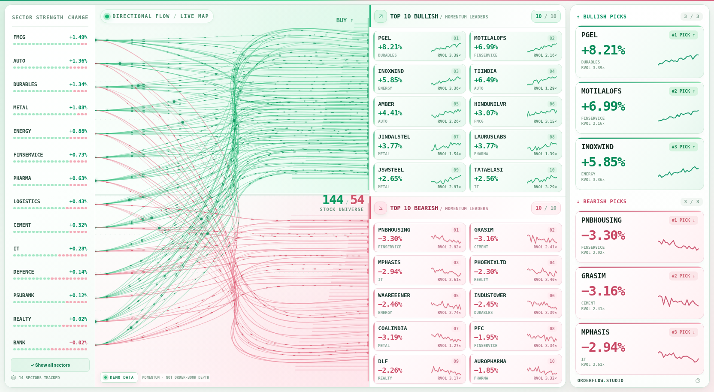
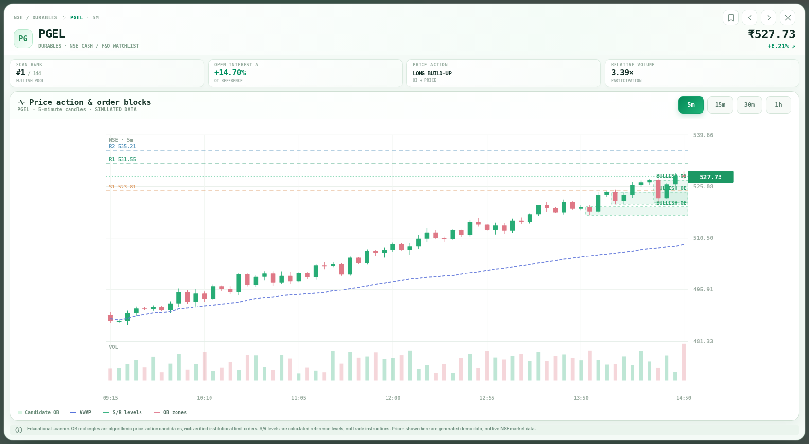

# OrderFlow Studio — Premium Top-10 + Big Chart Edition

An original, screenshot-inspired intraday NSE stock scanner with the 198 unique user-supplied symbols, 14 sector groups, green/red market flow, top-10 bullish and bearish lists, diversified top-three picks, and clickable 5m / 15m / 30m / 1h stock charts with VWAP, price structure, and candidate order blocks.

**Now supports Zerodha Kite Connect live market data.** The dashboard is **read-only** — it never creates or sends buy/sell orders.





[Watch the moving wires in a short demo preview](animated-wires-preview.mp4) · The preview uses synthetic demonstration market data, not Zerodha quotes.

## New: Full-screen, no-scroll trading-floor layout

The main dashboard now intentionally shows **only the four columns from your reference screenshot**, with no sidebar, header, KPI panels, footer, or page scrolling:

**14 sector-strength rows → moving green/red momentum wires → top 10 bullish + top 10 bearish stock tiles → top 3 picks on both sides.**

- The entire map is fitted into one browser viewport (`100dvh`), including all 14 sectors, 20 ranked stock tiles (10 per direction), and six pick cards. No dashboard column or browser page scrollbar is needed on tested desktop screen sizes.
- Green and red strands are **genuinely animated**: SVG line highlights travel along sector paths, and small luminous dots move along selected connections. Wire ends are grouped into bullish and bearish zones. Motion is disabled if your browser requests reduced animation.
- Sector filtering, picking a stock, and chart access still work. Selecting a stock opens a **viewport-fitted popover** with the selectable 5m / 15m / 30m / 1h price chart, VWAP, candidate order blocks, OI/price classification, and overlaid reference levels; it does not cause page scrolling.
- Typography and contrast are deliberately **bolder and brighter** than before. At very narrow widths the four columns get compact, so a desktop monitor is recommended.
- The small data-source indicator in the **lower-left of the wires panel** identifies `DEMO DATA` vs `KITE CONNECTED` / connection state. A connected WebSocket does not prove the market is presently open.
- The wires represent **modelled price momentum, not verified order-book depth, money transfers, or actual institutional orders**.

The fixed-screen presentation and wire animation are in `static/fullscreen.css` and `static/app.js`. The additional high-contrast premium treatment is in `static/premium.css`. The top-10 shortlist is enforced by `LEADER_LIMIT=10` in `server.py` and the top-three sector-diversified picks are selected from those ten per side. The original Kite backend, instrument mapping, streaming, and 5-minute data API continues to work, with higher-timeframe aggregation added.

**Chart-first detail view:** Clicking a symbol opens one enlarged multi-timeframe candlestick chart spanning the available dialog width. The former six-tile **Price structure & reference levels** sidebar has been removed. Price levels remain available as optional lines directly on the chart via **S/R levels**, alongside **VWAP** and **OB zones**. The popover does not scroll. Select **5m**, **15m**, **30m**, or **1h** in the upper-right of the chart: each button reloads the actual OHLCV candles and recalculates candidate OB zones, volatility-derived support/resistance, and crosshair values at the selected interval. The active timeframe follows you when you open another stock. The current partial bar updates as new Kite ticks arrive.

## 1. Install and run — Kite Connect live mode

Use **Python 3.10+** and the **paid Kite Connect market-data plan**. (Zerodha's free Personal plan does **not** include live market-data WebSockets or historical 5-minute candles.)

```bash
# In the folder containing server.py:
python -m venv .venv
# macOS/Linux:
source .venv/bin/activate
# Windows PowerShell: .venv\Scripts\Activate.ps1
python -m pip install -r requirements.txt
```

Make your **private** settings file by copying `.env.example` to `.env`. Edit it in a text editor:

```dotenv
MARKET_MODE=kite
KITE_API_KEY=YOUR_EXISTING_KITE_API_KEY
KITE_ACCESS_TOKEN=YOUR_VALID_ACCESS_TOKEN_FOR_TODAY
HOST=127.0.0.1
PORT=8000
```

Start the server:

```bash
python server.py
```

Open **http://127.0.0.1:8000**. The data-source indicator at the bottom-left of the wires panel shows the Kite connection state after the WebSocket handshake. Hover over it to see the latest quote timestamp or the feed status/error. `GET /api/health` exposes mapped futures counts and missing stock mappings. Quotes may be **stale outside NSE trading hours**; the connection indicator does **not** imply that the exchange is currently open.

**Important security**: keep the API key and access token in your `.env` file on your own computer. Never upload real secrets to ChatGPT, paste them into browser source code, or commit `.env` to Git. `.env` is in `.gitignore` and **not included** in this ZIP. Don't expose port 8000 to the public internet; the local UI has no user login. Use `127.0.0.1` (default).

Zerodha access tokens are **short-lived**, normally expiring by the next trading day. When it expires, generate a new access token through Zerodha's authorized login procedure, update `.env`, then restart this program. Having an API key alone does not enable the live feed.

## 2. How live market data works

1. On launch, the backend downloads Zerodha's **current NSE and NFO instrument masters** and resolves symbol names to numeric instrument tokens. Symbols that cannot be matched exactly are omitted; the app will **not silently substitute** another instrument.
2. It initializes stock prices using a single set of NSE cash `quote` requests so cards display even after market close.
3. A single KiteTicker WebSocket subscribes to **cash-equity stocks in QUOTE mode** (LTP, previous close, volume, OHLC, available average price) and **nearest-expiry, nonexpired NFO stock futures in FULL mode** (OI when available).
4. NSE cash last traded prices determine bullish/bearish direction. The scanner uses percent move, available VWAP alignment, and optional futures-OI observations to compute its *own* strength score. It is **not a reverse-engineering of order-block.com's private proprietary ranking algorithm**.
5. The dashboard publishes updates to the browser over **Server-Sent Events every ~2 seconds**, not once per raw WebSocket tick.
6. Clicking a symbol loads **Kite historical 5-minute OHLCV candles on demand** (for up to about 18 calendar days of history, subject to Kite availability), cached for 60 seconds and rate-limited, and overlays live quote updates. The chart auto-refreshes roughly every 15 seconds while open.
7. VWAP is constructed from candlestick (typical price × candle volume), with the running calculation **reset each trading session**; Kite's session average traded price is preferred in the quick summary when supplied.
8. Candidate order blocks are calculated from candle-price action using a preceding opposing candle, impulse, and local break of structure. **These rectangles are not actual order-book liquidity or verified institutional orders.** Support/resistance bands are simple volatility-derived reference levels, not entry signals.

### NSE cash vs NFO futures open interest

- **Cash equities do not have a meaningful derivatives OI stream.** Their cash price is displayed separately from the nearest listed *stock futures contract's* OI.
- OI is shown **only** when a matching, unexpired NFO FUT instrument exists and the Kite feed returns that value; otherwise the UI displays `N/A` / `OI UNAVAILABLE`.
- The displayed `FUTURES OI Δ` is relative to the **first observed OI since the app connected**, not last day's OI. This distinction matters for "long build-up" and "short covering" interpretations; it should not be mistaken for exchange-reported previous-day OI change.
- `RVOL` displays **N/A** in Kite mode unless a verified baseline has been supplied. The app does not invent previous-day volume or populate a fake `1×` participation reading. Missing RVOL contributes only a neutral weighting to ranking.
- Stocks in your configured list are **not all guaranteed to be active F&O stocks today**. Their live eligibility depends on what the NSE/NFO instrument masters actually contain. `NIFTY_50` is a **cross-sector watchlist**, not an additional sector, so it is not double counted.

### Selectable candle timeframes (new)

The chart header has four bold buttons: **5m | 15m | 30m | 1h**. They change the candle aggregation itself—not merely its title or zoom. The server retains 5-minute bars from Kite and aggregates OHLCV without crossing session boundaries; a 1-hour candle is anchored at the NSE 09:15 IST open (09:15–10:15, 10:15–11:15, etc). Bar VWAP is inherited from the last constituent 5-minute bar to keep the same session VWAP reference; price structure and order blocks are computed on the selected candles. Session dates appear on the x-axis when history spans multiple trading days.

Use `GET /api/symbol/PGEL?timeframe=5m`, `?timeframe=15m`, `?timeframe=30m` or `?timeframe=1h`. Unsupported values return HTTP 400. The Kite connection and access token remain server-side. **Historical availability and OB zone counts depend on the data actually received** (a very short history may yield no candidate order blocks). Current/incomplete candles are provisional.

### 5-minute volume and live-feed limitations

The live Kite QUOTE feed provides **cumulative traded volume**, not individual exchange transaction volume. This adapter calculates positive deltas between consecutive quotes (resetting at each new trading session). When you start halfway through a 5-minute period, the initial tick cannot reconstruct earlier traded volume in that bar. Historical 5-minute candles from Kite backfill when you open the stock; the newest candle remains provisional until it closes. A single WebSocket is used for all configured cash symbols plus any eligible futures, remaining within Kite's documented subscription capacity.

The on-demand history cache limits API use, but no feed can guarantee zero missed ticks over lost network connections. This scanner is for research/educational monitoring and requires thorough backtesting and reconciliation before taking trading decisions.

## 3. Demo mode — no broker credentials

To try the UI offline, change `.env` to `MARKET_MODE=demo` (or remove `.env`, which defaults to demo), restart and visit the same URL. **Every demo number is synthetic** and labelled as a demo. Demo data is never silently substituted for Kite data if authentication fails; Kite mode instead displays a connection error.

## 4. Legacy authenticated external tick-ingestion mode (optional)

The original project is preserved for custom licensed feeds. This is separate from the **direct Kite integration** above:

```dotenv
MARKET_MODE=live
MARKET_FEED_TOKEN=your-private-long-string
```

Then `POST /api/ingest` with header `X-Feed-Token`. This endpoint is **disabled in Kite mode** to prevent accidental mixing of external and Zerodha data. The included `examples/ingest_jsonl.py` demonstrates that legacy protocol.

## 5. Endpoints and testing

| Endpoint | Description |
|---|---|
| `GET /` | Interactive dashboard |
| `GET /api/state` | Ranked stock list, sector matrix, feed health and breadth |
| `GET /api/symbol/PGEL?timeframe=15m` | Selected stock detail with 5m, 15m, 30m or 1h candles and recomputed order blocks/levels (default 5m) |
| `GET /api/universe` | All exact configured symbols, sectors and NIFTY_50 watchlist |
| `GET /api/health` | `mode`, `feedStatus`, `lastQuoteAt`, count of missing mappings |
| `GET /api/events` | SSE browser event stream |
| `POST /api/ingest` | Legacy custom-feed mode only (disabled for Kite / demo) |

To run all offline integration tests:

```bash
python -m unittest -v
```

`test_kite_feed.py` uses a stubbed Kite client and ticker to verify instrument mapping, subscription modes, 5-minute history, OI, daily volume changes, and reconnection handling without requesting real credentials or connecting to the internet. The real Zerodha connection **cannot be verified without your valid live tokens and network access**.

## 6. Project layout

```text
orderflow-studio/
├── .env.example         # template only — no keys or tokens
├── .gitignore           # prevents accidental .env commit
├── README.md
├── requirements.txt     # FastAPI, uvicorn, official kiteconnect, python-dotenv
├── sectors.py           # exact user-provided SECTOR_DEFINITIONS & ALL_SYMBOLS
├── server.py            # ranking engine, OB/VWAP/5m OHLC, SSE, FastAPI
├── kite_feed.py         # real Zerodha instruments/quote/WebSocket/history adapter
├── test_scanner.py      # scanner computation tests
├── test_kite_feed.py    # Kite integration tests with stubbed SDK
├── examples/ingest_jsonl.py
└── static/
    ├── index.html
    ├── app.js            # flow diagram, top 10→3, stock detail, live chart refresh
    ├── styles.css        # core theme and detail-chart styling
    ├── fullscreen.css    # no-scroll 100dvh map; animated wires
    ├── premium.css       # high-contrast two-column top-10 tiles + larger chart
    └── favicon.svg
```

### Troubleshooting

- **KITE · ERROR**: ensure the token is valid today and your Kite Connect subscription includes paid market data. Restart after updating `.env`. Watch the server console for an exception class (credentials are never included in browser error messages).
- **Missing symbols**: some supplied names may be retired, renamed, or absent from Zerodha's current instrument master. Check `GET /api/health` for count and `GET /api/state` for the list; avoid manually guessing token IDs.
- **Prices not moving**: NSE may be closed or the feed may be reconnecting. Check `lastQuoteAt`, rather than equating a WebSocket connection with an open market.
- **Stock chart empty**: Kite historical-data entitlement / connection may be unavailable; the viewer shows only candles actually received by the feed. Opening a symbol triggers one on-demand history request, with a 60-second cache.
- **No OI for PGEL**: this is expected unless that stock has an eligible, quoted FUT contract; no fake OI is added.
- **Rate limits**: the server uses one market-data WebSocket, batched quote requests, and serialized, cached historical requests.

## Official Zerodha references

- [Official Python client](https://github.com/zerodha/pykiteconnect)
- [WebSocket streaming](https://kite.trade/docs/connect/v3/websocket/)
- [Historical candles](https://kite.trade/docs/connect/v3/historical/)
- [Instrument master and quote API](https://kite.trade/docs/connect/v3/market-quotes/)
- [Authentication / expiration](https://support.zerodha.com/category/trading-and-markets/general-kite/kite-api/articles/kite-connect-api-faqs)

**Read-only, educational project. No order placement. Not investment advice.** The dashboard is an original design inspired by the provided screenshots; it does not claim to reproduce the reference website's proprietary backend or ranking logic.
